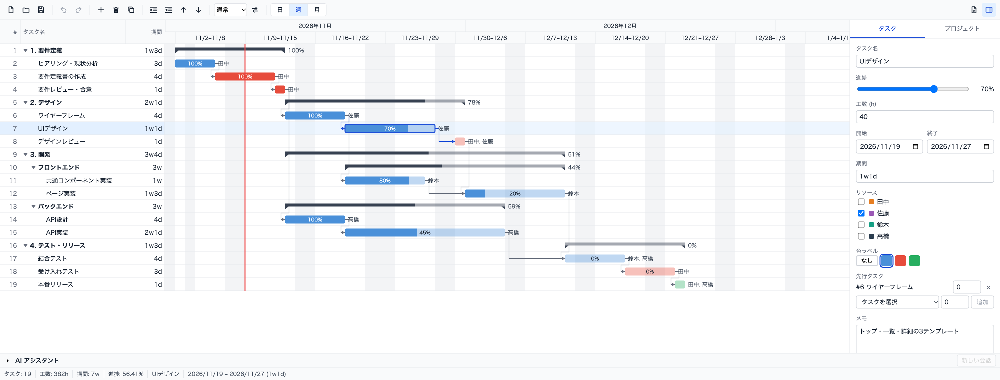

# json-gantt

JSON ファイルをそのままガントチャートとして編集できるデスクトップアプリです。
プロジェクトの正は 1 つの JSON ファイルで、アプリでの編集は JSON に書き戻され、JSON を直接編集(または AI に編集させ)てもアプリに反映されます。



## 特徴

- **階層タスク**: 親タスクはサマリーバーで、期間・進捗・工数は子から自動計算
- **FS 依存と自動スケジューリング**: 先行タスクが動くと後続タスクが後ろにずれる(ラグ/リード対応)
- **直感的な操作**: バーのドラッグ移動、右端ドラッグで期間変更、親バーのドラッグで子を一括移動
- **稼働日カレンダー**: 週末・祝日を除いて期間を計算(任意設定)
- **リソースと色ラベル**: 担当者の複数割り当て、色ラベルでバーを色分け
- **日 / 週 / 月ズーム**、折りたたみ、Undo / Redo
- **PDF 出力**: 表とタイムラインを一体で A3 横に出力(Noto Sans JP 埋め込み)
- **AI アシスタント**: ローカルの [Claude Code](https://claude.com/claude-code) CLI(`claude -p`)にスケジュール編集を依頼し、差分を確認してから取り込み(デスクトップ版のみ)
- **外部変更の検知**: ファイルが外部で変更されたら通知し、再読込か上書きかを選択
- **JSON Schema で検証**: スキーマ違反のファイルはエラー一覧を表示して開かない。未知のフィールドは保持

## サンプル

[`examples/website-renewal.json`](examples/website-renewal.json) に、上のスクリーンショットのサンプル(Web サイトリニューアル、19 タスク)があります。
アプリで開く、またはウィンドウにドラッグ&ドロップしてください。

## 開発

必要なもの: [Node.js](https://nodejs.org/)、[pnpm](https://pnpm.io/)、[Rust](https://www.rust-lang.org/tools/install)、[Tauri 2 の前提環境](https://v2.tauri.app/start/prerequisites/)

```sh
pnpm install
pnpm tauri dev      # デスクトップアプリとして起動
pnpm tauri build    # 配布用ビルド
```

| コマンド | 内容 |
|---|---|
| `pnpm dev` | フロントエンドのみブラウザで起動(ファイル I/O・PDF・AI は使えません) |
| `pnpm test` | vitest によるテスト |
| `pnpm typecheck` | 型チェック |
| `pnpm gen:types` | `schema/gantt.schema.json` から TS 型を再生成 |

## ファイルフォーマット

1 ファイル = 1 プロジェクトの JSON で、定義は [`schema/gantt.schema.json`](schema/gantt.schema.json)(JSON Schema draft 2020-12)です。

```json
{
  "$schema": "./schema/gantt.schema.json",
  "version": 1,
  "project": {
    "name": "Webサイトリニューアル",
    "calendar": { "weekends": [0, 6], "holidays": ["2026-11-03"] }
  },
  "resources": [{ "id": "…", "name": "田中", "color": "#E67E22" }],
  "colorLabels": [{ "id": "…", "name": "重要", "color": "#E74C3C" }],
  "tasks": [
    { "id": "…", "parentId": null, "name": "1. 要件定義" },
    {
      "id": "…", "parentId": "<親の id>", "name": "要件定義書の作成",
      "start": "2026-11-06", "end": "2026-11-11", "progress": 100, "hours": 32,
      "resourceIds": ["…"], "colorLabelId": "…",
      "dependencies": [{ "predecessorId": "…", "lag": 0 }]
    }
  ]
}
```

- 日付は `YYYY-MM-DD`(暦日)で、`end` は**包含**(1 日タスクは `start == end`)
- タスクはフラット配列で、階層は `parentId` で表現
- 親タスクの `start` / `end` / `progress` / `hours` は子から導出されるため、ファイルには書かれません
- 依存は FS(終了→開始)のみ

## ドキュメント

- [アーキテクチャ方針](docs/ARCHITECTURE.md)
- [詳細設計](docs/design/)(データモデル / エンジン / UI / バックエンド / AI ペイン)

## 技術スタック

Tauri 2 / React 18 / TypeScript / Vite / Zustand + immer / Rust(`serde_json`、`jsonschema`、`notify`、`usvg` + `svg2pdf`)
